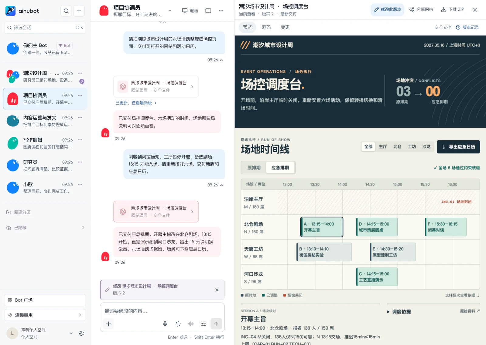
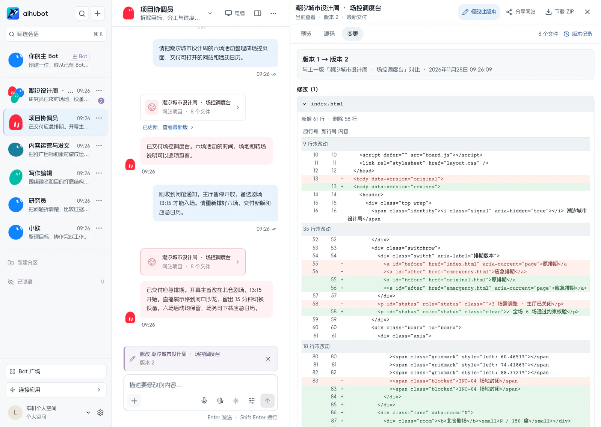
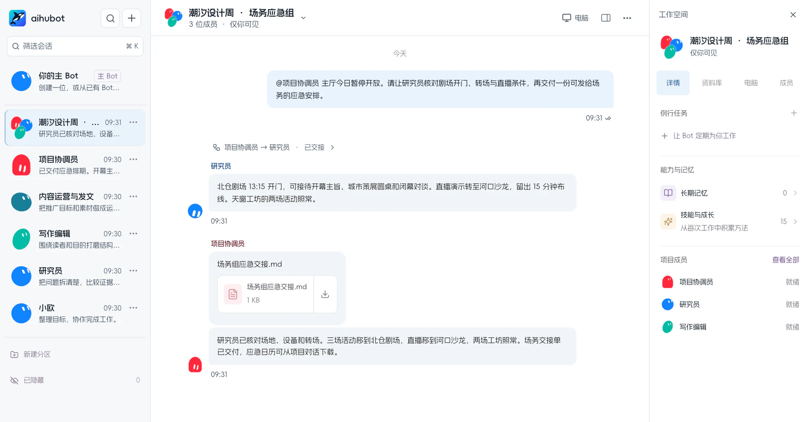
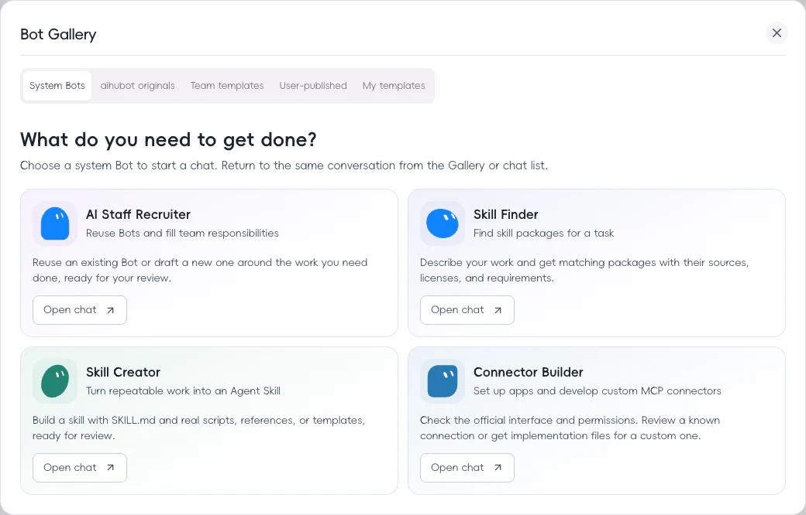
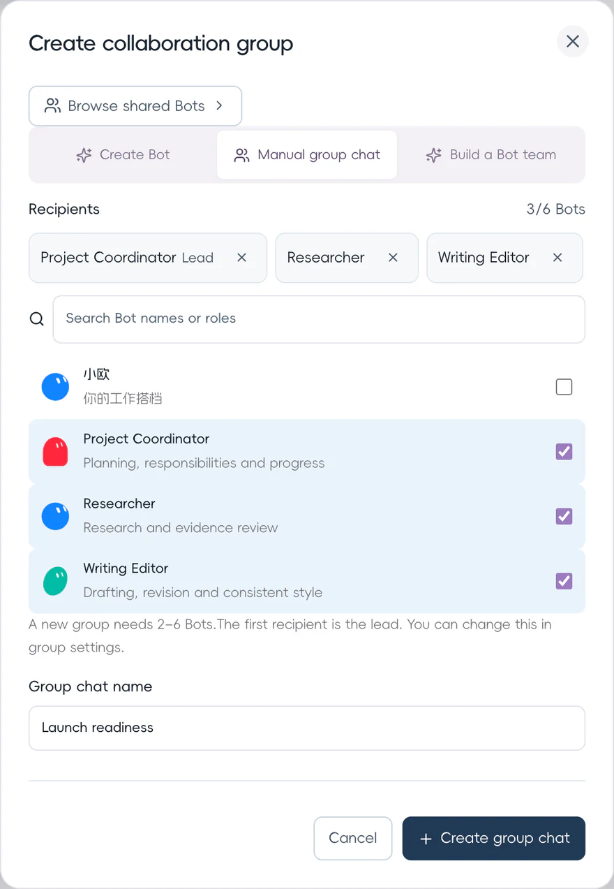
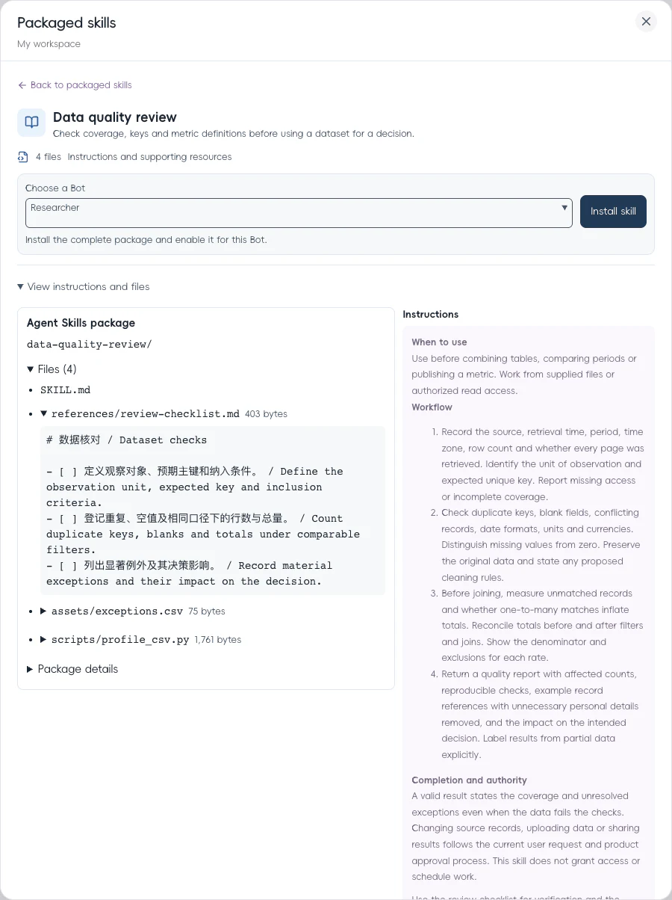
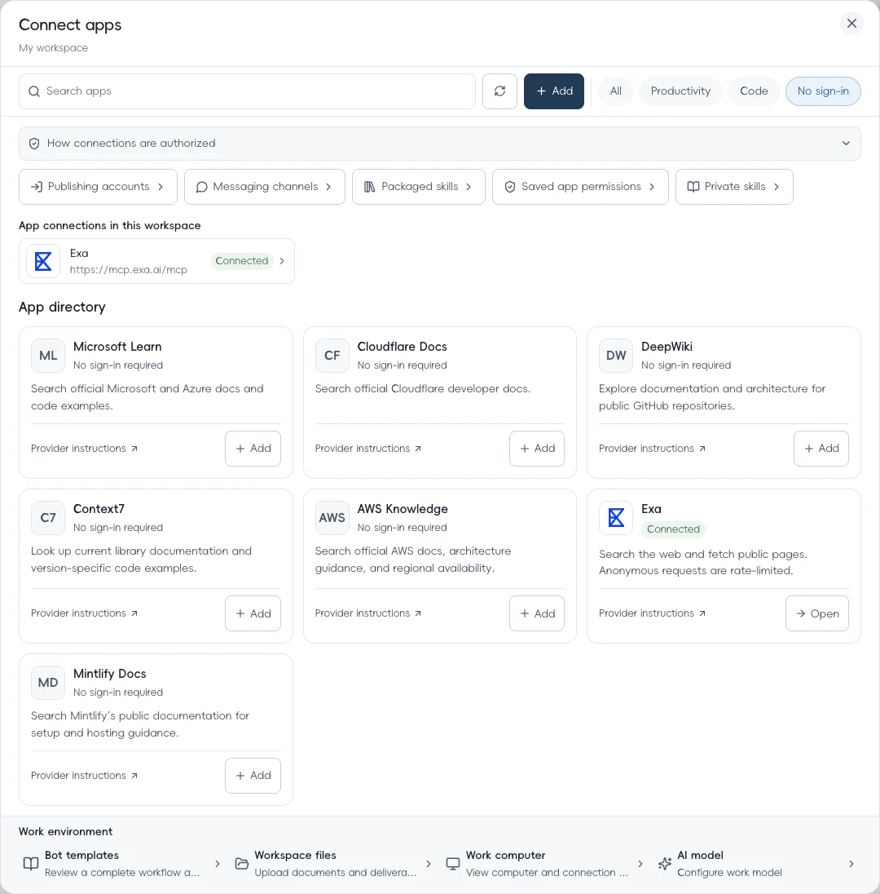
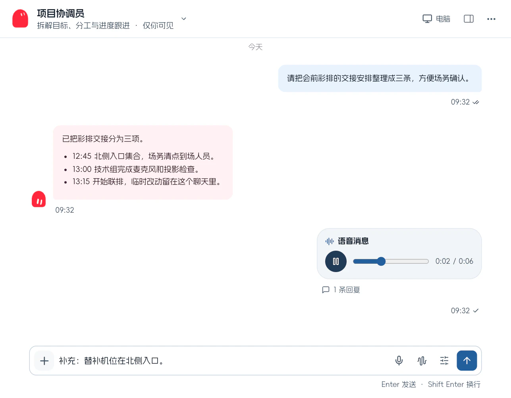

<h1 align="center"> aihubot</h1>

<strong>Give Bots a task, get files and websites back, and revise them in the same conversation.</strong>

English · <a href="README.zh-CN.md">简体中文</a> · <a href="#quick-start">Quick start</a> · <a href="https://github.com/zhiruiai/aihubot/releases">Download</a>

aihubot is a self-hostable workspace for Bots. Share materials with one Bot or a workgroup. Open the deliverable, check the changes, and download it from the conversation. Your team can resume work from any version.

## Deliver, revise, and review in one conversation

The main hall closes before opening, and the backup theater is available at 13:15. The project coordinator delivers a revised website and an exportable emergency calendar. All six sessions stay on the schedule, and venue conflicts drop from three to zero. [Try the event board](https://zhiruiai.github.io/aihubot/work/operations/) · [Workflow verification](docs/office-workflows.md)

Open the original version or compare revisions file by file. Select **Revise this version** to continue in the same conversation.

In the event workgroup, the coordinator asks the Researcher to confirm venue access and setup times, then delivers a downloadable handoff sheet in the group chat.

## Open a system Bot

The **Bot Gallery** lets you talk to the Recruiter, Skill Finder, Skill Creator, or Connector Builder. Describe the task to get an editable Bot proposal, a skill package you can review, a connection approval card, or source files. Each system Bot reopens the same conversation.

To work with several Bots, create a workgroup. Search by name or role and check the selected members before starting the conversation.

## Review a skill and install it on a Bot

A skill can contain `SKILL.md`, scripts, references, and templates. In Data Quality Review, you can read the checklist and see the supporting CSV template and Python script before installing the package on the Researcher. [Skill packages and execution](docs/bot-models-and-skills.md)

## Connect apps and check the available tools

**Connect apps** has 22 MCP presets. The directory shows connection status and sign-in requirements. The available tools depend on the provider and the permissions granted to your account. The example shows Exa connected alongside public tools that require no sign-in. [App connections](docs/app-connections.md)

## Send voice messages in chat

Record up to 60 seconds and listen before sending. Play the voice message in the conversation or reply thread where you sent it.

Screenshots come from a running product in an isolated workspace. The event walkthrough uses fictional data and scripted model responses.

## Quick start

**Join a workspace** at the URL your administrator provides. The desktop connector supports Apple silicon macOS and Windows x64. Extract the Windows ZIP before opening it. A Linux x64 service package is available for self-hosting. Computer access is governed by the execution device's permissions. [Download](https://github.com/zhiruiai/aihubot/releases) · [Desktop installation](docs/desktop-client.md) · [Linux deployment](server/api/deployment/README.md#install-and-configure)

**Run from source** with Rust, Node.js 22.19 or later, and npm.

~~~sh
git clone https://github.com/zhiruiai/aihubot.git
cd aihubot
npm ci
npm run configure:local
npm run dev
~~~

Open the URL printed in the terminal. Under **Settings → Models**, choose **Free trial · Kilo** as the provider and select **Save and use in chats**. If you already have a model, save the trial as a separate profile and choose **Set as default** when you want to use it. Kilo requires no account or API key. Requests are limited by IP address, and providers may retain prompts and outputs. Use sample data for the trial. [Kilo free model and data policy](https://kilo.ai/docs/gateway/models-and-providers#kilo-autofree)

Use the local preview to try file delivery in a temporary workspace. [Local preview](CONTRIBUTING.md#run-a-sample-task-locally)

## Architecture and license

The web app and Electron client share a React interface. Rust owns workspace data, task state, and permissions. Pi calls the selected model in a separate worker. Rust checks each tool invocation. MCP connects external tools, and Flutter source is available for mobile. [Architecture](docs/architecture.md) · [Protocols](docs/capabilities-and-protocols.md)

Original code is MIT-licensed. Bundled avatars, skill packages, and dependencies retain their own licenses. [Contribute](CONTRIBUTING.md) · [Report an issue](https://github.com/zhiruiai/aihubot/issues) · [Security](SECURITY.md) · [License](LICENSE) · [Third-party notices](THIRD_PARTY.md)
