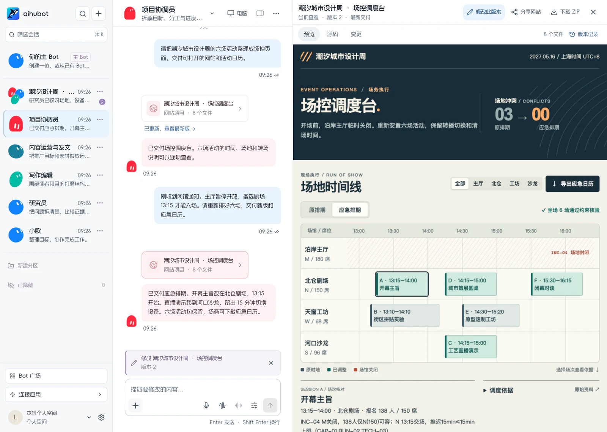
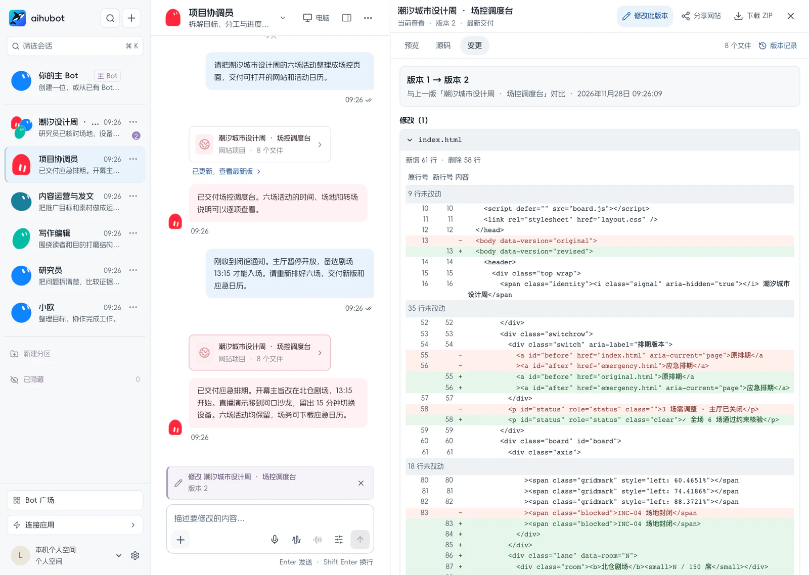
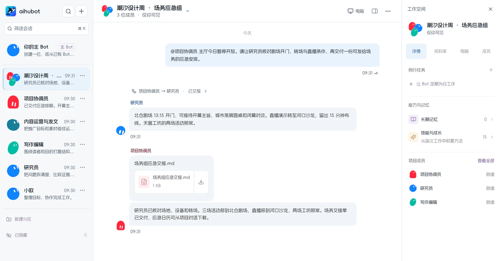
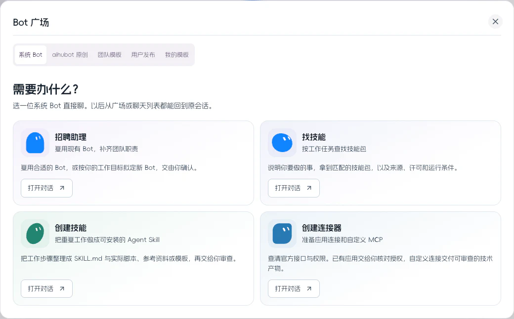
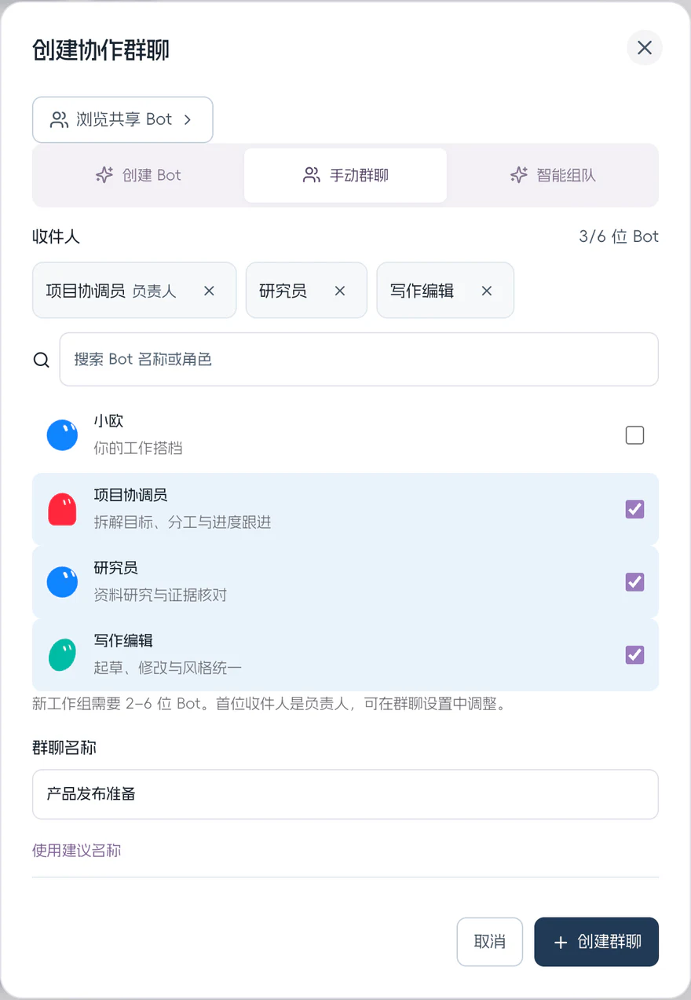
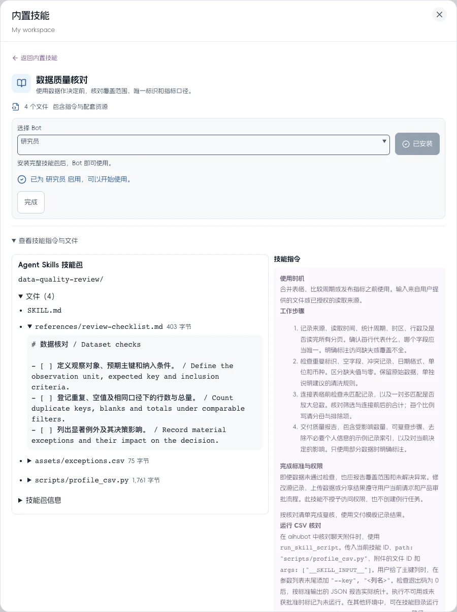
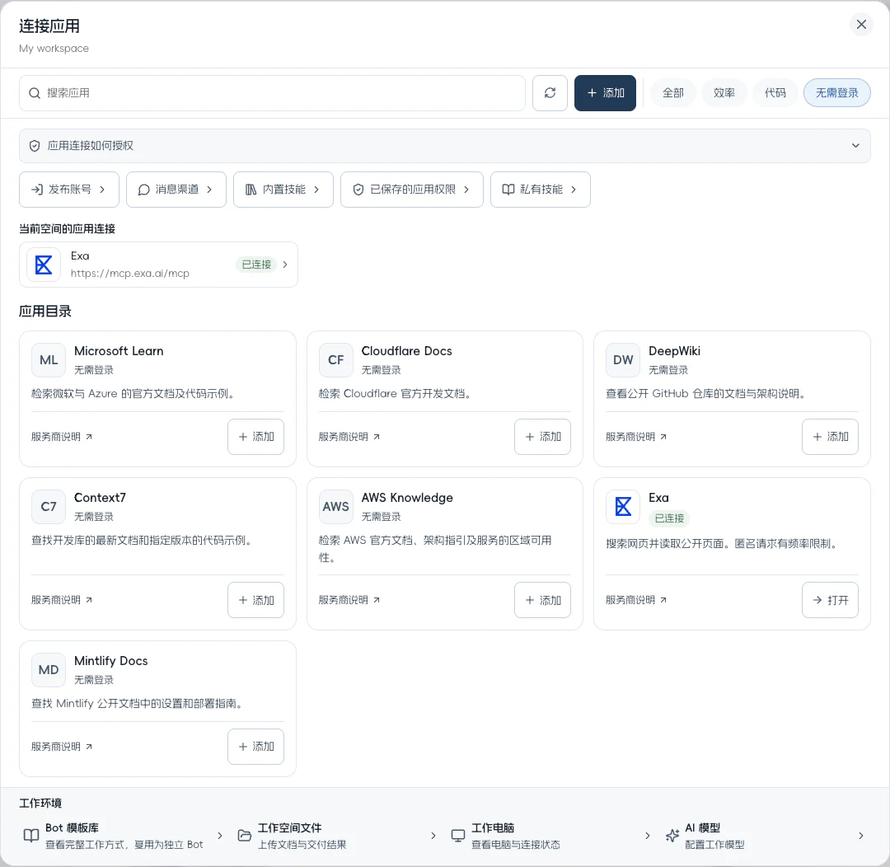
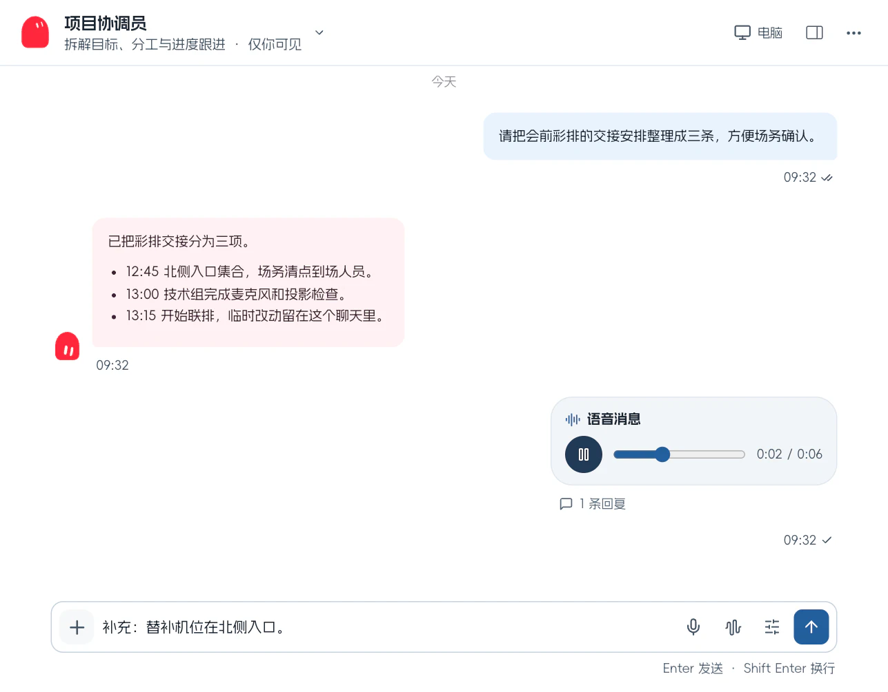

<h1 align="center"> aihubot</h1>

<strong>让 Bot 执行任务、交付文件和网站，并在原对话中继续修改。</strong>

简体中文 · <a href="README.md">English</a> · <a href="#快速开始">快速开始</a> · <a href="https://github.com/zhiruiai/aihubot/releases">下载客户端</a>

aihubot 是可以自托管的 Bot 工作空间。把资料交给单个 Bot 或工作组，在原对话打开成品、核对修改和下载。团队可以从任何一版继续协作。

## 在同一个对话里交付、修改和复核

开场前主厅关闭，备用剧场 13:15 才能进场。项目协调员按新条件交付网站第二版和可导出的应急日历，六场活动全部保留，场地冲突从三处降到零。 [体验调度台](https://zhiruiai.github.io/aihubot/work/operations/) · [案例验收记录](docs/office-workflows.md)

打开第一版或逐文件查看修订差异。点「修改此版本」即可在原对话接着改。

在场务工作组里，项目协调员请研究员核对场地开放和设备准备时间，再把可下载的交接单发到群里。

## 直接找系统 Bot

在 **Bot 广场** 打开招聘助理、找技能、创建技能或创建连接器，描述想办的事。招聘助理给出可编辑的 Bot 草案，技能助手交付可检查的包，连接器助手把授权入口或源码交回对话。再次打开会回到原会话。

任务需要不同角色时，可以创建工作组。按名称或职责查找 Bot，确认已选成员后就能开始对话。

## 审查技能包，再装到需要的 Bot

技能可以包含 `SKILL.md`、脚本、参考资料和模板。以「数据质量核对」为例，可以先展开检查清单，核对包内的 CSV 模板和 Python 脚本，再把完整技能包装到研究员。 [技能包与脚本执行](docs/bot-models-and-skills.md)

## 连接应用并核对可用工具

**连接应用** 提供 22 项 MCP 预设。界面标明连接状态和登录方式，实际可用的工具取决于服务商及账号权限。图中 Exa 已连接，可在无登录分类查找公开资料工具。 [应用连接说明](docs/app-connections.md)

## 在聊天里发送语音

一段录音可以先试听再发送，最长 60 秒。在原对话或回复线程中打开语音胶囊，就能继续播放。

截图来自独立空间中运行的产品。活动案例使用虚构业务资料与预设模型回复。

## 快速开始

**已有工作空间**可以通过管理员提供的地址登录。连接客户端支持 Apple 芯片 Mac 和 Windows x64，Windows 版请完整解压后启动。Linux x64 服务包支持自托管。电脑操作按执行端授权启用。 [下载版本](https://github.com/zhiruiai/aihubot/releases) · [桌面端安装说明](docs/desktop-client.md) · [Linux 部署](server/api/deployment/README.md#install-and-configure)

**从源码运行**需要 Rust、Node.js 22.19 或以上版本，以及 npm。

~~~sh
git clone https://github.com/zhiruiai/aihubot.git
cd aihubot
npm ci
npm run configure:local
npm run dev
~~~

打开终端显示的产品地址，进入 **设置 → 模型配置**。在服务商里选 **免费试用 · Kilo**，然后点 **保存并用于对话**。已配置过模型时，先保存试用配置，再按需点 **设为默认**。无需注册 Kilo 或填写 API Key。试用按 IP 限流，服务商可能保留输入和输出，请使用示例资料。 [Kilo 免费模型与数据说明](https://kilo.ai/docs/gateway/models-and-providers#kilo-autofree)

也可以用临时空间试用文件交付。 [开发预览](CONTRIBUTING.md#run-a-sample-task-locally)

## 架构与许可

Web 与 Electron 共用 React 界面。Rust 管理工作区数据、任务和权限。Pi 在独立 Worker 中调用所选模型，工具执行由 Rust 校验。可通过 MCP 连接外部工具，移动端提供 Flutter 源码。 [系统架构](docs/architecture.md) · [协议与能力范围](docs/capabilities-and-protocols.md)

项目原创代码采用 MIT 许可。随附的头像、技能和依赖保留各自许可。 [贡献指南](CONTRIBUTING.md) · [问题反馈](https://github.com/zhiruiai/aihubot/issues) · [安全反馈](SECURITY.md) · [许可证](LICENSE) · [第三方声明](THIRD_PARTY.md)
